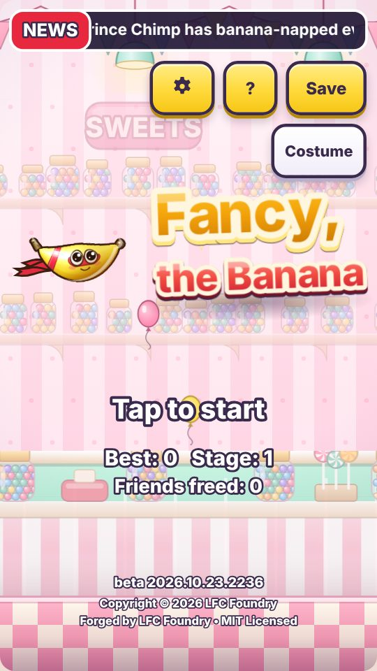
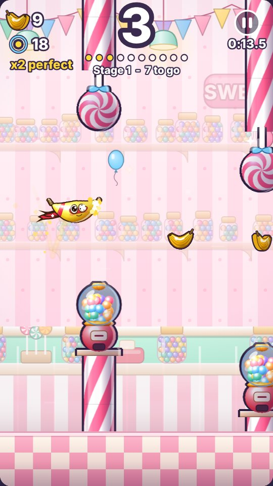
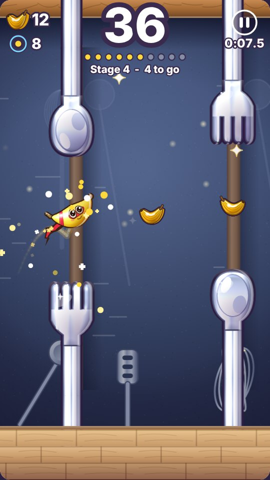
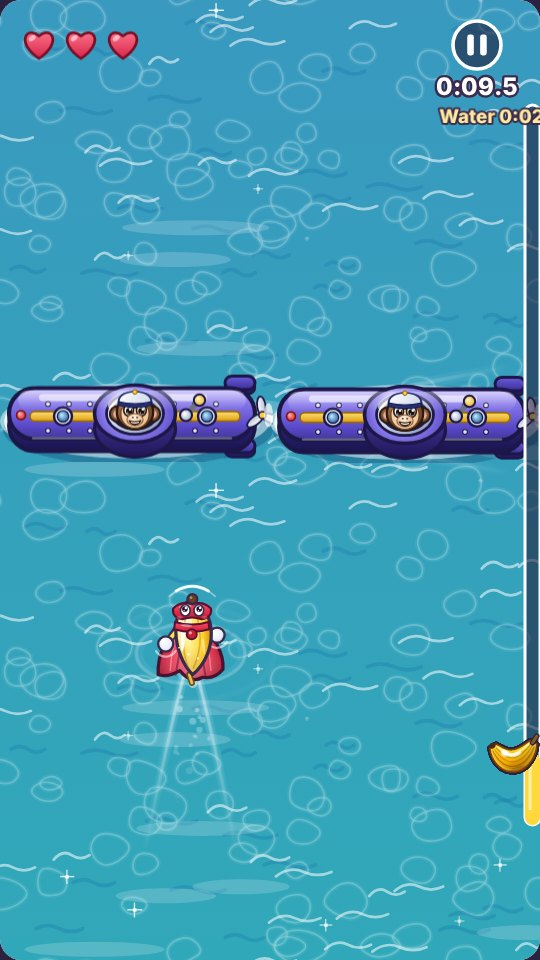
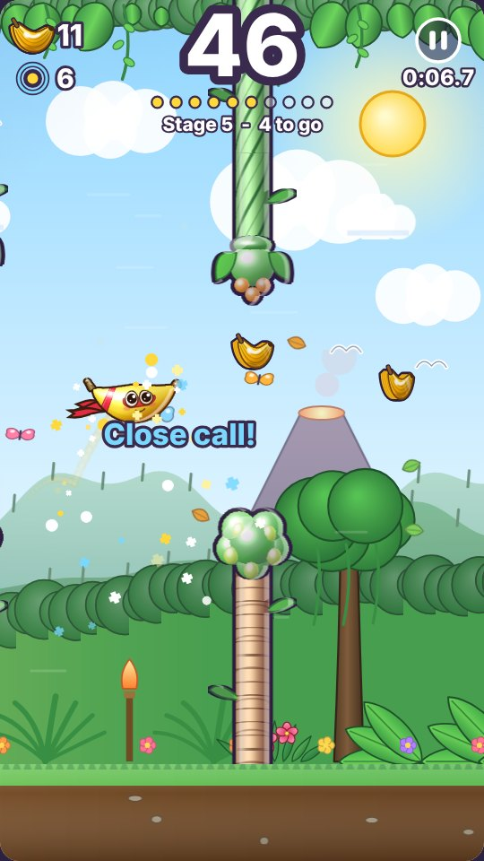

# Fancy, the Banana (beta)

A silent, one-tap, side-scrolling arcade game. Guide Fancy, a small flying banana in a hero mask and scarf, through the gaps and free his banana friends from Evil Prince Chimp.

**Play it: https://jnfoo.github.io/fancy-banana/**

  
  
  
  
  

**Status: beta.** The game is feature-complete and being polished and tested, so small things still change between versions. What changed and when is in [changelog.md](changelog.md).

## How to play

- **Tap, click or press Space** to flap. Fly through the gates; touch an obstacle or the ground and the run ends.
- Every ten gates is a new stage, and each stage clear sets five banana friends free.
- Grab golden banana coins, fly through the middle of a gap for a PERFECT streak, and skim an edge for a close call.
- After stage 4 comes **Chimp's Navy**, a water bonus level seen from above: drag, move the mouse or use the arrow keys to steer, and tap to leap over submarines and barrels.
- Spend your banana credits (friends freed plus coins) on upgrades such as wider gaps, a gentler fall, a free bounce, a banana magnet and Potassium Power, and pick a costume on the title screen.
- Every run starts with a loop-de-loop launch, and Prince Chimp is waiting at the end of the Jungle Kingdom.
- Beat him and the game starts to hide things: there are secrets, challenges, costumes and a few surprises for anyone who keeps playing.

**Stages:** Candy Shop, Jam Jar Pantry, Ice Cream Parlor, Silverware Drawer, the water level, then the Fruit Garden (it starts on a beach and turns into the jungle island) and Prince Chimp's Jungle Kingdom. In each run, one of stages 2 to 4 is picked by chance and flipped like a card, so Fancy flies right to left.

## Made to be comfortable

Calm mode (no flashes, shake or zoom), game speed from 100% down to 60%, left-handed layout, large buttons and text, a battery saver, full screen, a pause button (or the P key), game controller support, and no sound or music at all. Progress is saved in your browser; use **Save** to copy a save code or file and move to another device.

## Technical notes

- The whole game is one HTML file: no install, no sign-in, no network requests, nothing leaves your device, and it works offline. Open `index.html` in any modern browser on a laptop or a phone.
- It uses plain HTML canvas and JavaScript with no libraries. There are no image files in the game: all of its art is drawn by code when it starts and built in small background steps so play stays smooth.
- Physics runs at a fixed 120 steps a second and the picture is drawn where things will be when it is shown. Test builds run in Firefox (used as the stress test) and Chromium.
- Version numbers look like `2026.10.10.2346`: year, month, day and the time (US Eastern). The current one is shown under the title on the title screen.
- This repository holds the built game (`index.html`), the [changelog](changelog.md) and the screenshots above.

© 2026 JNFoo. All rights reserved.

## More from JNFoo

- [Apple Press](https://github.com/JNFoo/apple-press): a clicker game for kids ([play](https://jnfoo.github.io/apple-press/))
- [browser-game-toolkit](https://github.com/JNFoo/browser-game-toolkit): small open-source (MIT) pieces for single-file browser games ([demos](https://jnfoo.github.io/browser-game-toolkit/))
