

# Fancy, the Banana

**A silent, one-tap flying banana arcade game. Free the banana friends from Evil Prince Chimp.**

[**Play it now**](https://lfcfoundry.github.io/fancy-banana/) · [**Source code**](https://github.com/lfcfoundry/fancy-banana)

   

**No ads · no accounts · no data sent anywhere · no microtransactions · fully open source · single player · works offline · works in any modern browser**

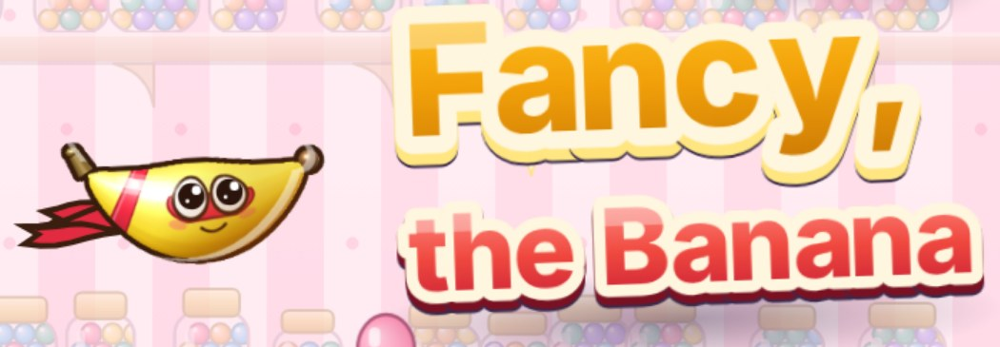

## What it is and how it works

Guide Fancy, a small flying banana in a hero mask and scarf, through the gaps of a side-scrolling course. One tap, click or Space press flaps. The whole game is one HTML file in plain canvas and JavaScript, with no libraries and no image files; all the art is drawn by code when the game starts.

## Why it exists

A game anyone can open anywhere: one tap and no sound, so it works where sound is not welcome, with nothing to install and nothing leaving your device. Comfort is built in, and some of its code is shared as modules in [JS-modules](https://github.com/lfcfoundry/JS-modules).

## Highlights

| One tap | Easy to learn | Made to be comfortable | Quiet by design | Stages and a water level | Free and private |
|---|---|---|---|---|---|
| Tap, click or press Space. Fixed physics at 120 steps a second. | A ? button on the title screen opens a picture-by-picture How to play. No forced tutorial: tap start whenever you like. | Calm mode, game speed down to 60%, left-handed layout, no flashing. | No sound or music at all: everything is seen and touched, with less to take in at once. | Candy Shop, Jam Jar Pantry, Ice Cream Parlor, Silverware Drawer, Chimp's Navy, the Fruit Garden and Prince Chimp's Jungle Kingdom. | No ads, accounts or purchases, and nothing sent anywhere. Progress is saved in your browser. |

## Free, private and open

- **No ads.** Nothing to watch or skip. The game has no libraries and makes no network requests, so there is nowhere for an ad to come from.
- **No accounts.** No sign-in and no profile. Progress is saved in your own browser; Save gives you a code or file to keep or move.
- **No data sent anywhere.** Zero network requests: none were made during 15 seconds of play when checked in Chromium. Nothing leaves your device.
- **No microtransactions.** Banana credits are earned by playing (friends freed plus coins). Nothing in the game is for sale.
- **Fully open source.** MIT license. The readable source is in src/ in this repository, with the steps to rebuild the game.
- **Works offline.** Once the page has opened, or after you save the file, it needs no connection. There is no background download or offline install, so the first open needs a connection unless you already have the file.
- **Single player.** One player on one device. No online play, chat or leaderboards, and nothing to unlock with other people.
- **Easy on any modern browser.** Chromium, Firefox and WebKitGTK are tested for every release. The game fits screens from 320 x 568 up to 2560 x 1440 in all three, and it needs no install.

  
  
  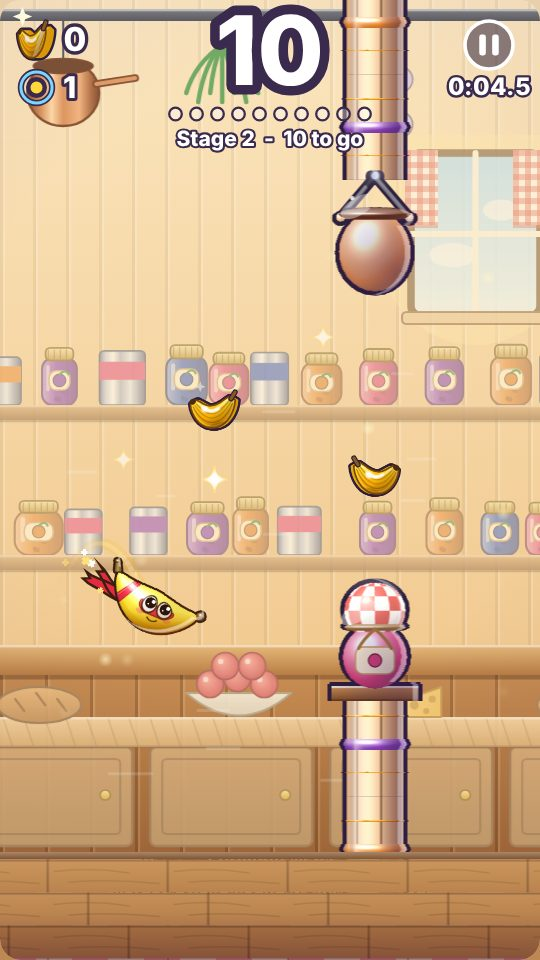
  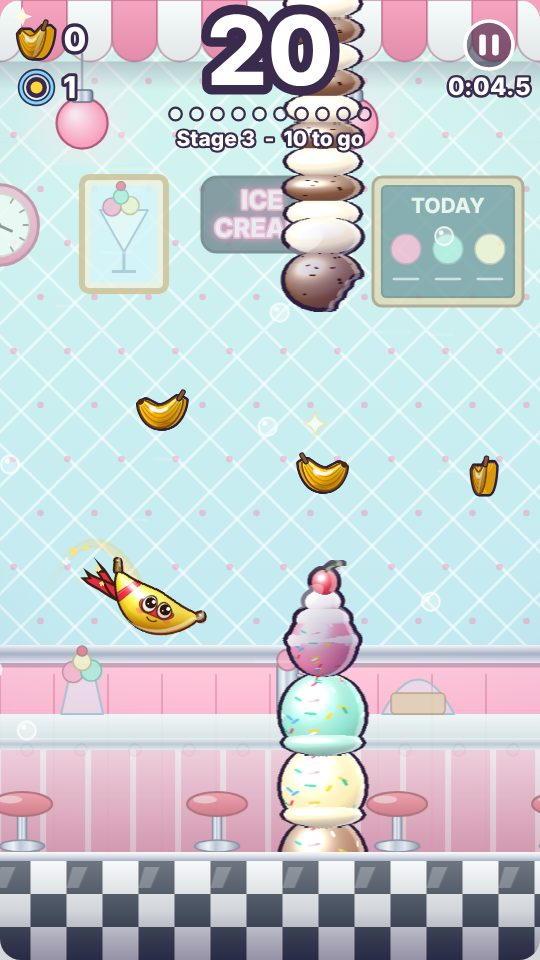
  
  
  
  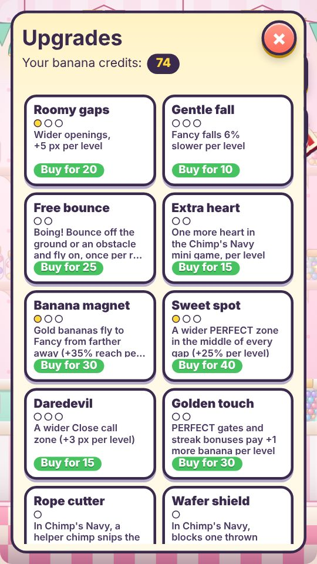

**Status: beta.** The game is feature-complete and being polished and tested, so small things still change between versions. What changed in each version is in [changelog.md](changelog.md), a short list of what you will notice.

## Upgrades

Spend banana credits (friends freed plus coins) in the shop: 15 upgrades with 30 levels, 1,635 credits for all of them. A few examples, shown as the game draws them in its shop:

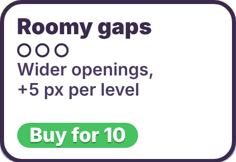 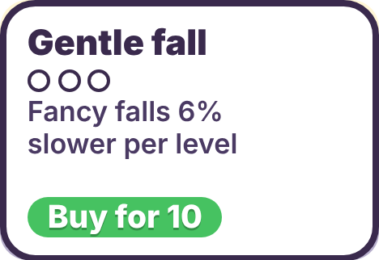 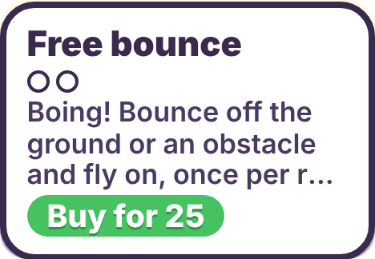 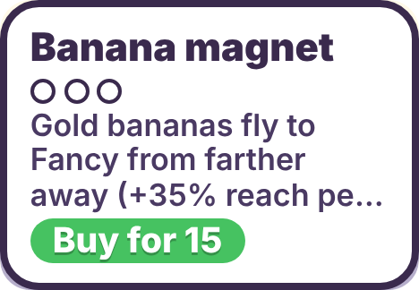 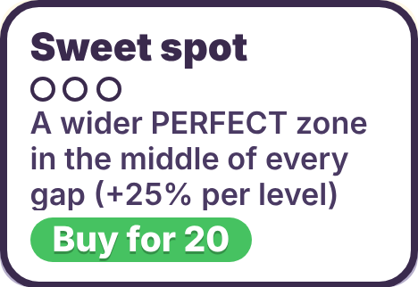 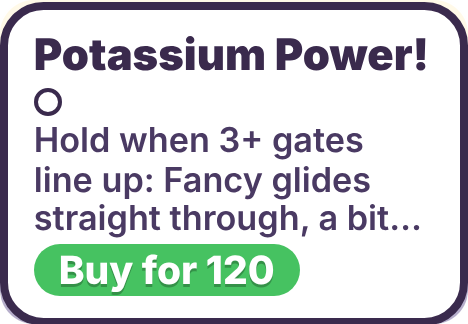 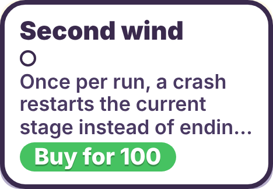 

| Upgrade | What it does | Levels and cost |
|---|---|---|
| Roomy gaps | Wider openings, +5 px per level | 3 levels, 10 to 30 credits |
| Gentle fall | Fancy falls 6% slower per level | 3 levels, 10 to 30 credits |
| Free bounce | Bounce off the ground or an obstacle and fly on, once per run per level | 2 levels, 25 and 50 credits |
| Banana magnet | Gold bananas fly to Fancy from farther away, +35% reach per level | 3 levels, 15 to 45 credits |
| Sweet spot | A wider PERFECT zone in the middle of every gap, +25% per level | 3 levels, 20 to 60 credits |
| Potassium Power! | Hold when three or more gates line up and Fancy glides straight through, a bit faster | 1 level, 120 credits |
| Second wind | Once per run, a crash restarts the stage you are in | 1 level, 100 credits |

## By the numbers

| | |
|---|---|
| Physics | Fixed, 120 steps a second |
| Size | One file, about 500 KB, no libraries and no image files |
| Network | No requests, no sign-in, no trackers |
| Frame work | Median 0.4 ms, under 2 ms for 99% of frames (Chromium, phone-size view) |
| Memory | Flat over 10 minutes of play (Chromium) |
| Checked | Chromium, Firefox and WebKitGTK for every release |

Measured on build 2026.10.23.2236.

## How to play

The game has a built-in guide: tap the **?** button on the title screen for a picture-by-picture How to play (flapping, stages, coins, Chimp's Navy, pause and controller tips). There is no forced tutorial, so you can start right away.

- **Tap, click or press Space** to flap. Fly through the gates; touch an obstacle or the ground and the run ends.
- Every ten gates is a new stage, and each stage clear sets five banana friends free.
- Grab golden banana coins, fly through the middle of a gap for a PERFECT streak, and skim an edge for a close call.
- After stage 4 comes **Chimp's Navy**, a water bonus level seen from above: drag, move the mouse or use the arrow keys to steer, and tap to leap over submarines and barrels.
- Spend your banana credits (friends freed plus coins) on upgrades such as wider gaps, a gentler fall, a free bounce, a banana magnet and Potassium Power, and pick a costume on the title screen.
- Every run starts with a loop-de-loop launch, and Prince Chimp is waiting at the end of the Jungle Kingdom.
- Beat him and the game starts to hide things: there are secrets, challenges, costumes and a few surprises for anyone who keeps playing.

**Stages:** Candy Shop, Jam Jar Pantry, Ice Cream Parlor, Silverware Drawer, the water level, then the Fruit Garden (it starts on a beach and turns into the jungle island) and Prince Chimp's Jungle Kingdom. In each run, one of stages 2 to 4 is picked by chance and flipped like a card, so Fancy flies right to left.

## Made to be comfortable

The game has no sound and no music, ever, so there are no sudden sounds and nothing depends on hearing. Every cue is something you see, and the whole game is played by touch with one tap, a click or the Space key, which leaves less to take in at once and can be easier on players who find noise and busy screens tiring. Calm mode (no flashes, shake or zoom), game speed from 100% down to 60%, left-handed layout, large buttons and text, a battery saver, full screen, a pause button (or the P key), game controller support, and no sound or music at all. Progress is saved in your browser; use **Save** to copy a save code or file and move to another device.

## Tested with

Every release is checked in real browsers, one at a time. The table lists the browsers and versions used for each build. The full technical changelog, with numbers, is kept by the maker outside this page.

| Builds | Chromium | Firefox | Notes |
|---|---|---|---|
| 2026.10.08.2342 | Chromium only, version not recorded | not yet in use | First build. |
| 2026.10.08.2351 to 2026.10.16.1032 | Version not recorded (early notes name Playwright's Chromium build 1194) | 158.0b5, driven through Puppeteer (WebDriver BiDi) | By the end the automatic checks numbered 91 in Chromium and 26 in Firefox. Firefox 153 was used for some timing and freeze runs on 2026.10.11 to 2026.10.12. Some early entries record no browser check. |
| 2026.10.16.1651 | not run | not run | Text-only fix, rebuilt from source and compared byte for byte with the live page. |
| 2026.10.16.2201 | 153 for the title screen before release; ungoogled Chromium 155.0.8059.39: 91 of 91 checks after release | 158.0b5: 26 of 26 checks (third run; two timing checks failed first) | Copyright change. |
| Rule from 2026.10.17 | Ungoogled Chromium 155.0.8059.39 | Firefox 158.0 | Plus WebKitGTK 2.52.6 and GNOME Web 46.5. Only these browsers, one at a time, versions labeled. |
| Rule from 2026.10.24 | Ungoogled Chromium 155.0.8059.39 | Firefox 158.0 | WebKitGTK 2.52.6 only. GNOME Web is no longer tested; the rows below from before this date keep their results. |
| 2026.10.22.1855 | Ungoogled Chromium 155.0.8059.39: 91 of 91 checks | Firefox 158.0: 26 of 26 checks | Plus WebKitGTK 2.52.6: 3 of 3 and GNOME Web 46.5: 3 of 3, and the saved-pictures check 4 of 4. Pictures compared with the previous build in all four browsers: 100.000% identical. |
| 2026.10.22.2025 | Ungoogled Chromium 155.0.8059.39: full checks green | Firefox 158.0: full checks green | Plus WebKitGTK 2.52.6 and GNOME Web 46.5: opened with no script errors. Pictures compared with the previous build in all four browsers: 100.000% identical. |
| 2026.10.22.2026 | Ungoogled Chromium 155.0.8059.39: full checks green | Firefox 158.0: full checks green | Plus WebKitGTK 2.52.6 and GNOME Web 46.5: opened with no script errors. Pictures compared with the previous build in all four browsers: 100.000% identical. |
| 2026.10.22.2131 | Ungoogled Chromium 155.0.8059.39: full checks green | Firefox 158.0: full checks green | Plus WebKitGTK 2.52.6 and GNOME Web 46.5: opened with no script errors. Pictures compared with the previous build in all four browsers: 100.000% identical. |
| 2026.10.22.2219 | Ungoogled Chromium 155.0.8059.39: full checks green | Firefox 158.0: full checks green | Plus WebKitGTK 2.52.6 and GNOME Web 46.5: opened with no script errors. Pictures compared with the previous build in all four browsers: 100.000% identical. |
| 2026.10.22.2251 | Ungoogled Chromium 155.0.8059.39: full checks green | Firefox 158.0: full checks green | Plus WebKitGTK 2.52.6 and GNOME Web 46.5: opened with no script errors. Pictures compared with the previous build in all four browsers: 100.000% identical. |
| 2026.10.23.0013 | Ungoogled Chromium 155.0.8059.39: full checks green | Firefox 158.0: full checks green | Plus WebKitGTK 2.52.6 and GNOME Web 46.5: opened with no script errors. Pictures compared with the previous build in all four browsers: 100.000% identical. Two copies open at once: tested in Chromium and Firefox. |
| 2026.10.23.2236 | Ungoogled Chromium 155.0.8059.39: full checks green | Firefox 158.0: full checks green | Plus WebKitGTK 2.52.6: opened with no script errors. Pictures compared with the previous build in all three browsers: 100.000% identical. |
| 2026.10.22.1903 | Ungoogled Chromium 155.0.8059.39: 91 of 91 checks | Firefox 158.0: 26 of 26 checks | Plus WebKitGTK 2.52.6: 3 of 3 and GNOME Web 46.5: 3 of 3, and the saved-pictures check 4 of 4. Pictures compared with the previous build in all four browsers: 100.000% identical. |
| 2026.10.22.1905 | Ungoogled Chromium 155.0.8059.39: 91 of 91 checks | Firefox 158.0: 26 of 26 checks | Plus WebKitGTK 2.52.6: 3 of 3 and GNOME Web 46.5: 3 of 3, and the saved-pictures check 4 of 4. Pictures compared with the previous build in all four browsers: 100.000% identical. |

The maker also checks by hand on a Windows 11 laptop (Ryzen 7 8845HS, Radeon 780M) in Firefox, and on a Pixel 7 Pro in Chrome. Those versions are not recorded.

## Technical notes

- The whole game is one HTML file: no install, no sign-in, no network requests, nothing leaves your device, and it works offline. Open `index.html` in any modern browser on a laptop or a phone.
- It uses plain HTML canvas and JavaScript with no libraries. There are no image files in the game: all of its art is drawn by code when it starts and built in small background steps so play stays smooth.
- Physics runs at a fixed 120 steps a second and the picture is drawn where things will be when it is shown. Test builds run in Firefox (used as the stress test), ungoogled Chromium and WebKitGTK; see [Tested with](#tested-with).
- Version numbers look like `2026.10.10.2346`: year, month, day and the time (US Eastern). The current one is shown under the title on the title screen.
- This repository holds the built game (`index.html`), its readable [source and rebuild steps](src/README.md), the [changelog](changelog.md), the screenshots above, [notes for AI assistants](AGENTS.md) and the commit hooks in `tools/hooks/`.

## Credits and attributions

- **Made by LFC Foundry.** Game design, code and art are by the maker, published under the name LFC Foundry. The title screen credits LFC Foundry and the page header links to github.com/lfcfoundry.
- **No third-party code or art in the game.** There are no libraries, fonts or image files in `index.html`; the screenshots above were taken from the game itself.
- **Reusable pieces.** Where a piece of the game's code has been published as a module, it lives in [JS-modules](https://github.com/lfcfoundry/JS-modules) under the same MIT license.
- **Testing tools and browsers.** Checks are driven with Puppeteer and Playwright (Firefox and Chromium) and with WebDriver (WebKitGTK; GNOME Web until 2026.10.24). The browsers are Firefox (MPL 2.0), ungoogled-chromium (BSD-3-Clause), WebKitGTK (LGPL-2 and BSD-2) and, until 2026.10.24, GNOME Web (GPL-3+); each keeps its own license. Versions used are listed under [Tested with](#tested-with).
- **License.** MIT; see [LICENSE](LICENSE).

© 2026 LFC Foundry. Released under the [MIT License](LICENSE).

## More from LFC Foundry

- [Apple Press](https://github.com/lfcfoundry/apple-press): a clicker game for kids ([play](https://lfcfoundry.github.io/apple-press/))
- [Pineapple Defense](https://github.com/lfcfoundry/pineapple-defense): a flick-to-throw pineapples-at-penguins game ([play](https://lfcfoundry.github.io/pineapple-defense/))
- [JS-modules](https://github.com/lfcfoundry/JS-modules): small open-source (MIT) pieces for single-file browser games ([demos](https://lfcfoundry.github.io/JS-modules/))
